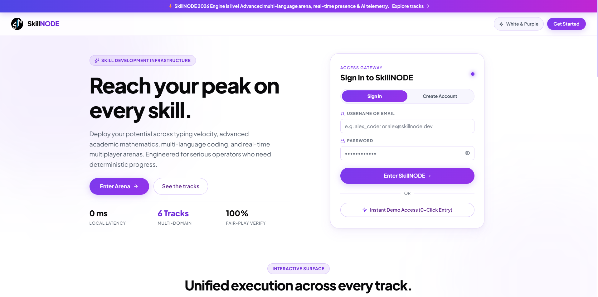
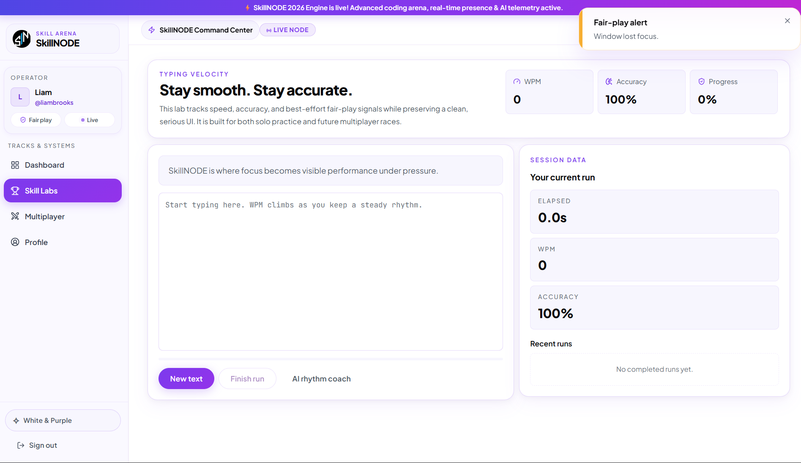
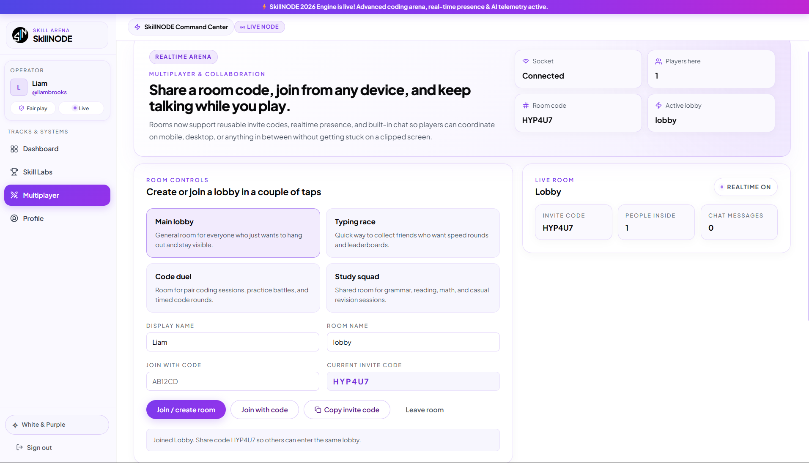
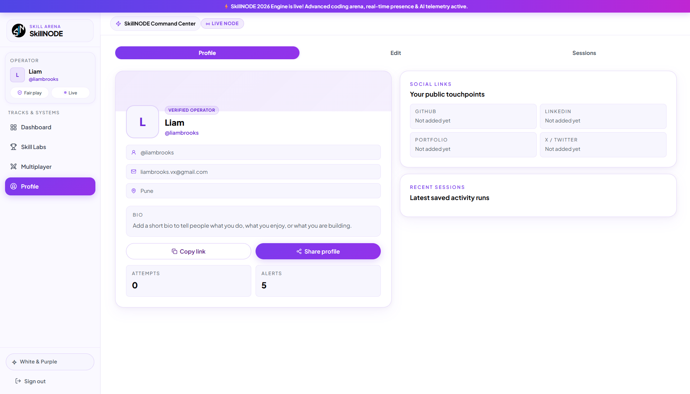

<p align="center">
  
</p>

# <p align="center">SkillNODE</p>
<p align="center">
  A local-first skill training platform with structured practice tracks, real-time multiplayer, AI-assisted coaching, and professional identity management.
</p>

<p align="center">
  
  
  
  
  
  
  
  
</p>

<p align="center">
  <a href="https://skillnode-azure.vercel.app/login"><strong>Live Application</strong></a>
  &nbsp;|&nbsp;
  <a href="https://skillnode-api.onrender.com/healthz"><strong>API Health Status</strong></a>
</p>

---

## Overview

SkillNODE is a full-stack monorepo web application for structured cognitive and technical skill training. It consolidates multi-domain practice environments, persistent user identity, challenge-based execution, AI coaching, fair-play monitoring, and real-time multiplayer into a single cohesive platform.

The monorepo is partitioned into two workspaces:

| Workspace | Stack | Responsibility |
|-----------|-------|----------------|
| `client/` | React 19 + Vite 7 + Tailwind CSS | SPA frontend — dashboard, skill tracks, profile, multiplayer UI |
| `server/` | Express 4 + Prisma + Socket.IO | REST API, AI endpoints, WebSocket presence, auth |

---

## Features

- **Dashboard** — Command-center layout with telemetry aggregation, session logs, and leaderboard surfaces.
- **Skill Tracks** — Typing, advanced mathematics (grade 11–12), data estimation, multi-language coding arena, grammar, and reading comprehension.
- **Coding Arena** — Challenge tracks for JavaScript, Python, C++, Java, TypeScript, and SQL.
- **AI Coaching** — Contextual algorithmic hints powered by OpenAI, integrated into supported challenge surfaces.
- **Real-time Multiplayer** — Preset rooms, custom room creation, and live peer presence via Socket.IO.
- **Player Identity** — Profile studio with avatar, biography, region, social links, and public shareable profile cards.
- **Fair-play Monitoring** — Integrity alerts and anomaly logging within the telemetry layer.
- **Instant Start** — Begin practicing right away with browser-side sessions. No login needed.
- **Responsive Design** — Fully responsive layouts for desktop and mobile viewports.

---

## Screenshots

<table>
  <tr>
    <td width="50%" valign="top">
      
      <br />
      <strong>1. Access Gateway & Landing</strong>
      <br />
      Flutter-inspired landing experience with deterministic credential and 0-click demo authentication.
    </td>
    <td width="50%" valign="top">
      
      <br />
      <strong>2. Execution Lab & Fair-Play</strong>
      <br />
      Focused practice arena tracking cadence, real-time WPM, accuracy, and window blur anomalies.
    </td>
  </tr>
  <tr>
    <td width="50%" valign="top">
      
      <br />
      <strong>3. Multiplayer Battle Rooms</strong>
      <br />
      Real-time Socket.IO room coordination, instant invite codes, and synchronized peer presence.
    </td>
    <td width="50%" valign="top">
      
      <br />
      <strong>4. Operator Profile Studio</strong>
      <br />
      Local-first player identity with verified operator badge, bio, and shareable performance records.
    </td>
  </tr>
</table>

---

## Tech Stack

### Frontend

| Dependency | Version | Purpose |
|------------|---------|---------|
| React | `19.2.4` | UI framework |
| Vite | `7.3.1` | Build tool & dev server |
| React Router | `7.13.2` | Client-side routing |
| Tailwind CSS | `3.4.19` | Utility-first CSS |
| Framer Motion | `12.38.0` | Animations & transitions |
| Axios | `1.14.0` | HTTP client |
| Socket.IO Client | `4.8.3` | WebSocket client |
| Lucide React | `1.7.0` | Icon library |

### Backend

| Dependency | Version | Purpose |
|------------|---------|---------|
| Express | `4.21.2` | HTTP server framework |
| Prisma | `6.16.1` | ORM & database toolkit |
| Socket.IO | `4.8.3` | WebSocket server |
| Zod | `3.25.76` | Schema validation |
| OpenAI SDK | `5.22.0` | AI coaching integration |
| Helmet | `8.1.0` | Security headers |
| rate-limiter-flexible | `7.3.1` | Rate limiting |
| JSON Web Token | `9.0.2` | Authentication tokens |
| Resend | `6.1.0` | Transactional email |
| Multer | `1.4.5-lts.2` | File upload handling |

### Infrastructure

| Tool | Purpose |
|------|---------|
| PostgreSQL 16 | Primary database (via Docker for local dev) |
| Docker Compose | Local service orchestration |
| npm workspaces | Monorepo dependency management |
| Vercel | Frontend deployment |
| Render | Backend deployment |

---

## Architecture

```
┌────────────────────────────────────────────────────┐
│                     Client (SPA)                   │
│  React 19 · Vite 7 · Tailwind · Framer Motion     │
│                                                    │
│  ┌──────────┐ ┌──────────┐ ┌───────────────────┐  │
│  │Dashboard │ │Activities│ │  Profile / Multi   │  │
│  └────┬─────┘ └────┬─────┘ └────────┬──────────┘  │
│       │             │                │             │
│       └─────────────┼────────────────┘             │
│                     │  Axios / Socket.IO Client    │
└─────────────────────┼──────────────────────────────┘
                      │
            ┌─────────▼──────────┐
            │   Express Server   │
            │                    │
            │  ┌──────────────┐  │
            │  │   REST API   │  │
            │  │  /api/ai     │  │
            │  │  /api/auth   │  │
            │  └──────┬───────┘  │
            │         │          │
            │  ┌──────▼───────┐  │
            │  │  Socket.IO   │  │
            │  │  (Realtime)  │  │
            │  └──────────────┘  │
            │                    │
            │  Helmet · Zod ·    │
            │  Rate Limiter      │
            └─────────┬──────────┘
                      │
            ┌─────────▼──────────┐
            │   PostgreSQL 16    │
            │   (via Prisma)     │
            └────────────────────┘
```

### Data Model

The Prisma schema defines four core models:

| Model | Purpose |
|-------|---------|
| `User` | Player identity — name, email, avatar, bio, social links |
| `LoginChallenge` | Passwordless email-code authentication flow |
| `AuditEvent` | Fair-play and security event log |
| `ActivityResult` | Per-session scores, accuracy, duration, and metadata |

Activity types: `typing`, `math`, `guess`, `coding`, `grammar`, `comprehension`.

---

## Project Structure

```
SkillNODE/
├── client/
│   ├── public/                # Static assets & logo
│   ├── src/
│   │   ├── components/        # Reusable UI components
│   │   ├── data/              # Static data & constants
│   │   ├── hooks/             # Custom React hooks
│   │   ├── lib/               # Utilities & API client
│   │   ├── pages/             # Route-level page components
│   │   └── styles/            # Global styles & Tailwind config
│   ├── package.json
│   └── vercel.json
├── server/
│   ├── prisma/                # Schema & migrations
│   ├── src/
│   │   ├── ai/                # OpenAI integration logic
│   │   ├── auth/              # JWT & email-code auth
│   │   ├── email/             # Transactional email (Resend)
│   │   ├── middleware/        # Helmet, CORS, rate limiting
│   │   ├── realtime/          # Socket.IO room & presence
│   │   └── routes/            # Express route handlers
│   └── package.json
├── docs/readme/               # README screenshots
├── tests/                     # Test suites
├── docker-compose.yml         # Local PostgreSQL
├── render.yaml                # Render deployment blueprint
├── package.json               # Root workspace config
├── LICENSE
└── README.md
```

---

## Getting Started

### Prerequisites

| Tool | Version |
|------|---------|
| Node.js | `22.x` |
| npm | `10+` |
| Docker | Latest (for local PostgreSQL) |

### Installation

```bash
# Clone the repository
git clone <repo-url> && cd SkillNODE

# Install all workspace dependencies
npm install

# Start the local PostgreSQL database
docker-compose up -d postgres

# Push the Prisma schema to the database
npm run db:push
```

### Environment Variables

Copy the `.env.example` in `server/` to `server/.env` and configure:

| Variable | Description |
|----------|-------------|
| `DATABASE_URL` | PostgreSQL connection string |
| `JWT_SECRET` | Secret for signing JWTs |
| `OPENAI_API_KEY` | OpenAI API key for AI coaching |
| `RESEND_API_KEY` | Resend API key for transactional email |
| `RESEND_FROM` | Sender address for emails |
| `PUBLIC_APP_URL` | Frontend origin for CORS |
| `PORT` | Server port (default: `5000`) |

### Development

```bash
# Start the backend (default: http://localhost:5000)
npm run dev:server

# Start the frontend (default: http://localhost:5173)
npm run dev:client
```

### Production Build

```bash
# Build both client and server
npm run build

# Build client only
npm run build:client
```

---

## Deployment

| Service | Platform | Config |
|---------|----------|--------|
| Frontend | Vercel | `client/vercel.json` — SPA rewrites |
| Backend | Render | `render.yaml` — build & start commands, env vars |

The `render.yaml` blueprint is ready for one-click Render deployment. Vercel auto-detects the `client/` workspace via its configuration.

---

## License

This project is proprietary software under the **Voxion Labs Proprietary Research License (VL-PRL)**.  
See [LICENSE](LICENSE) for the full terms.

---
<div align="center">
  (c) 2026 Voxion Labs & Rudranarayan Jena
</div>
